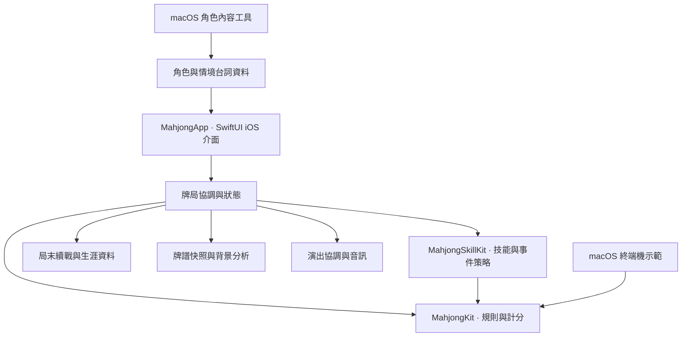

# 技術架構與設計取捨

這份文件介紹已採用的模組分工與工程思考，供技術展示使用，不包含私有實作內容。[返回產品總覽](README.md)

## 模組分工

Swift Package 的規則與技能層不依賴 iOS UI，App 負責把決策、動畫、聲音與保存串成玩家流程。規則模組可由測試與終端機示範直接驗證，降低單靠畫面猜測規則的成本。

目前部分 SwiftUI 畫面及牌局協調檔案仍偏大；模組邊界已有建立，但不宣稱整個 App 都已完成細緻拆分。

## 以合法牌局為基礎

胡牌、動作、計分與技能交換共用一致的牌張規則。第五張同牌不能出現在合法胡牌候選，槓牌額外實體張數與面子結構分開處理。收益技能修改付款效果，與傳統台數分開記錄，便於查核總額與來源。

**好處**：新增流派或事件時，可以保留既有規則不變，使用固定案例檢查變更是否破壞胡牌、暗槓門清或牌張守恆。

## 協調玩家決策與非同步流程

發牌、技能選擇、事件、AI、AUTO、結算及背景狀態各有流程限制。財神先產生精確報價，玩家確認後再次驗證局面與選項，交換成功才收費。決策帶有當次事件與局面識別，避免重複點擊或離開牌桌後，過期工作改動新局。

事件先發布遮罩與標題，之後才計算換牌及發布效果；較重的手牌分析延後至事件退場，動畫限制在事件區域。

**好處**：玩家能先看到回應，再進入決策；音畫與資料更新不必在同一幀競爭，過期操作也不會造成重複扣款。

## 背景分析與公開資訊

手牌分析依自己的手牌、摸張與完整面子建立工作與快取。換牌、切背景、事件、結算及離開會取消不再適用的分析；完成時再次確認局面，避免舊結果蓋回新手牌。

公開牌面計數排除已被取走的棄牌重複項，對手暗槓不作為已知牌種。AI 風險從自己的座位視角計算；牌譜只使用當時已記錄且可知的資訊。讀牌技能與暫時揭牌事件則是有期限的遊戲效果，結束後恢復隱藏。

**好處**：提示、AI、旁白與回顧有一致的資訊邊界，並讓分析工作盡量不阻擋主要觸控流程。

## 視覺與音訊各自有生命週期

演出協調器管理技能提示與破局佇列。連續破局使用同一張進場牌桌快照，最後一段才交接結果，略過與自然完成共用收尾流程。

背景錄音與動態短音分層處理；一般、張力、決勝依公開狀態選曲，切換使用交叉淡化。事件、結果與破局有播放優先權，淡出的舊播放器也遵守總聲音、背景與系統中斷。流派短音播放後清理，沒有動態節點時可讓引擎休眠。

**好處**：強化關鍵情緒時仍能控制播放順序，減少疊播、殘留音效及不用時的工作；實際耗電收益仍需真機量測，不以設計本身當成效能保證。

## 保存明確的安全點

目前選擇小局邊界保存。恢復內容包含進度、四家資金、莊家／連莊、角色、技能與已結算成果；不序列化整副半局牌牆與尚未完成事件。讀寫前驗證快照，舊格式可遷移，損壞原檔保留以利復原。

**好處**：在有限的保存範圍內維持一致性，避免一筆付款或獎勵恢復兩次。**代價**：半局中斷會重新洗牌發牌，完整原局恢復仍待開發。

## 內容與工程驗證配合

角色、個性、台詞與配音 ID 集中於內容資料，macOS 編輯工具提供表單及預覽，檢查 ID 和事件對應。缺少配音時不借用其他角色的聲音，避免角色辨識混亂。

規則測試覆蓋牌型與邊界，App 整合測試運行正式牌局模型與播放器，固定預覽驗證版面與演出。預覽牌局不寫入正式生涯、續戰或平衡統計。造型工作室的明確套用與一般設定仍按產品設計保存。

**好處**：內容新增與流程修改都有可追查的驗證入口；自動測試、模擬器操作與實機聽感分開記錄，讓展示成果有清楚界線。
