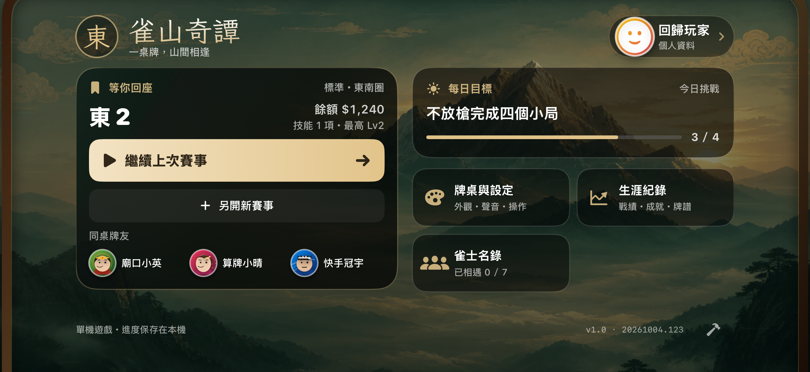
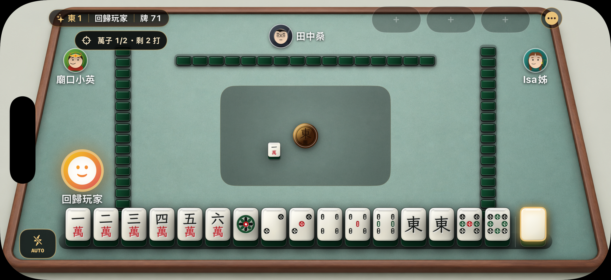
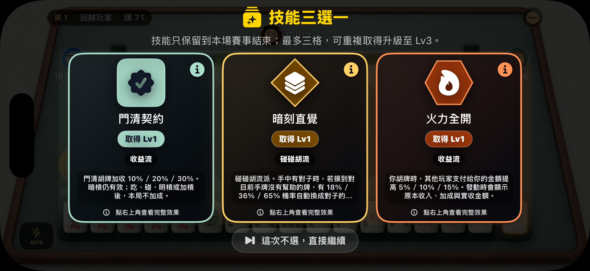
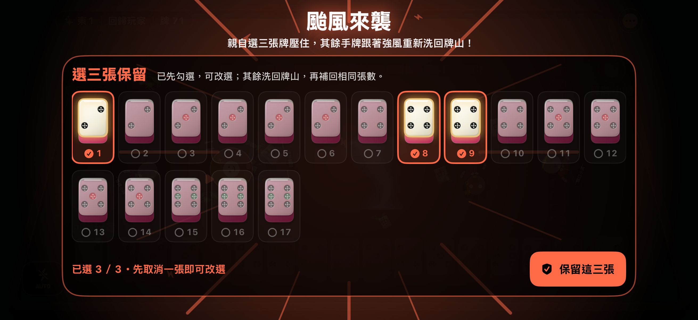
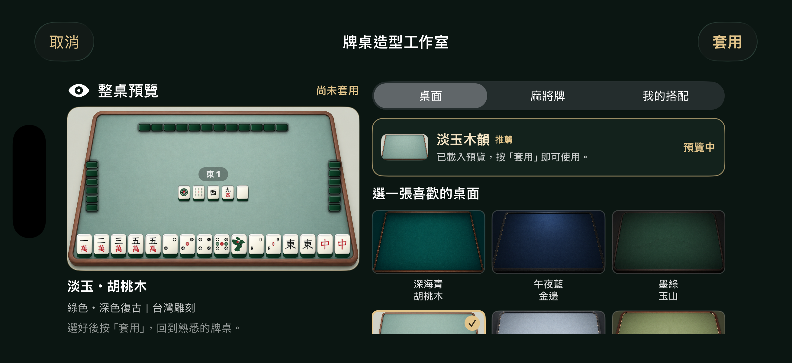
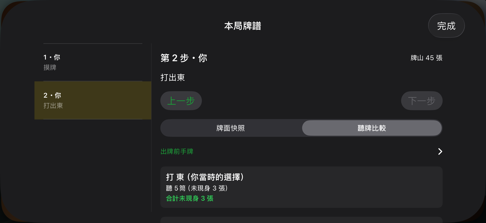
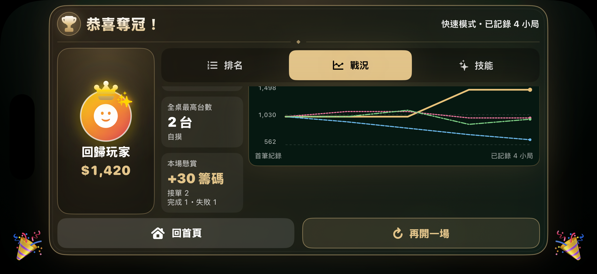

# 畫面與影片

以下均為 App 實際的 iPhone 模擬器畫面與固定情境錄影，使用示範玩家資料。不是設計稿，也不代表真機效能量測。[返回產品總覽](README.md)

## 首頁與續戰

2026 年 10 月 4 日 `.123` 畫面：主操作為繼續賽事，並呈現資金、技能、牌友與每日目標。此版首頁設計沿用至 `.125`。

## 牌桌與公開懸賞

`.125` 展示情境：萬子目標完成一張，尚餘兩次出牌。固定情境方便檢查進度徽章與手牌操作。

## 技能三選一

`.125` 三選一卡包含門清契約；摘要提供主要取捨，資訊按鈕可開完整說明。

## 自選保留三張

`.122` 實作的事件決策畫面，沿用至 `.125`。畫面中的牌型是刻意安排的測試情境，用來檢查同牌種能否按指定張數保留，不是自然發牌機率展示。

## 個人化造型

`.123` 工作室的推薦組合：先預覽、後套用；更換外觀與保存收藏採分開操作。

## 牌譜聽牌比較

10 月 3 日 `.119` 的固定教練資料，展示出牌前選擇與未現身張數。此處的「未現身」不等同可摸到的保證張數。

## 戰況與懸賞成果

`.125` 固定資料展示接單 2、成功 1、失敗 1、懸賞淨賺 30；示範成果只用於畫面驗證。

## 破局演出短片

[觀看約 30 秒的無聲破局示範](media/rupture-demo.mp4)

影片展示多段不同破局的撕裂、落字及回場銜接。這是集中演出的展示模式，正式賽事每場最多一次破局，並受技能等級與結算條件限制。影片沒有音軌，不用來示範兩首新配樂或作為音畫同步的驗收證據。
